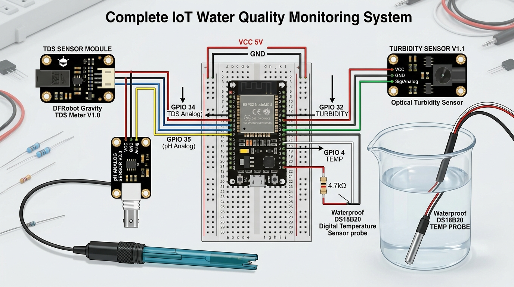

# AquaSense WQMS — IoT-Based Real-Time Multi-Parameter Water Quality Monitoring System

[](https://opensource.org/licenses/MIT)
[](https://www.espressif.com/)
[](https://flask.palletsprojects.com/)
[](https://mqtt.org/)
[](https://www.sqlite.org/)
[](https://bis.gov.in/)

> **B.Tech Computer Science & Engineering — Final Year Capstone Project (300 Marks Evaluation)**  
> Developed as a comprehensive **4-Month Capstone Engineering Project** by a collaborative **3-Member Team**.  
> **Full Presentation Deck (24 Slides):** [`docs/FINAL_YEAR_PRESENTATION_AND_TIMELINE_300_MARKS.md`](docs/FINAL_YEAR_PRESENTATION_AND_TIMELINE_300_MARKS.md)

---

## 1. Project Abstract

Drinking water contamination poses acute and chronic global health hazards, with conventional laboratory testing suffering from high turnaround latency and lack of continuous temporal visibility. **AquaSense WQMS** is an industrial-grade, full-stack Internet of Things (IoT) monitoring infrastructure engineered to perform real-time, in-situ assessment of **6 critical physicochemical water quality indicators**:
1. **Total Dissolved Solids (TDS)** — ppm (SEN0244 Analog Probe)
2. **pH Level** — Acidic/Alkaline equilibrium (E-201-C Glass Probe)
3. **Turbidity** — Suspended particulate cloudiness in NTU (SEN0189 Optical Sensor)
4. **Water Temperature** — °C with thermal compensation (DS18B20 1-Wire Probe)
5. **Dissolved Oxygen (DO)** — Aeration level in mg/L
6. **Electrical Conductivity (EC)** — Ionic concentration in µS/cm

The system edge layer utilizes an **ESP32 microcontroller** with a 40-sample median filtering algorithm that eliminates sensor noise and transmits JSON payloads over lightweight **MQTT** (or direct HTTP ingestion) to a local **Python Flask** server. Records are cataloged in an **SQLite** database via SQLAlchemy ORM, and evaluated against a deterministic **Water Quality Index (WQI)** engine matching **WHO** and **Bureau of Indian Standards (BIS IS 10500:2012)** criteria. The client presents an ultra-responsive light-themed dashboard featuring **6 dedicated visual speedometer and dial meters**, historical trend waveforms, automated contamination alerts, and one-click CSV audit export.

---

## 2. Project Team & Work Distribution (3-Member Core Team)

This capstone project was planned, executed, and validated collaboratively over a structured 60-day development window. Responsibility domains were categorized according to specialized engineering disciplines:

```text
========================================================================================
                          PROJECT WORK DISTRIBUTION MATRIX
========================================================================================
 TEAM MEMBER           ROLE                           PRIMARY DELIVERABLES
----------------------------------------------------------------------------------------
 Member 1:             Frontend UI/UX & AI/ML         • Responsive Glassmorphism Dashboard (`index.html`, `style.css`)
 NAILA JAVED           Analytics Lead                 • 6 Custom SVG 220° Sweep Speedometers & Dial Meters
                                                      • Weighted Water Quality Index (WQI) Algorithmic Engine
                                                      • Chart.js Multi-Parameter Waveforms (`script.js`)
                                                      • Mobile QR Scanner & Official PDF Inspection Certificate
----------------------------------------------------------------------------------------
 Member 2:             IoT & Sensors Embedded         • ESP32 Pinout & Analog ADC1 Channel Allocation
 APARNA PANDEY         Systems Lead                   • Sensor Interfacing (TDS SEN0244, pH E-201-C, Turbidity, DS18B20)
                                                      • C++ Firmware (`hardware/tds_sensor.ino`)
                                                      • 40-Sample Bubble-Sort Noise Median Filter Algorithm
                                                      • Temperature Compensation Math & 3-Buffer Sensor Calibration
----------------------------------------------------------------------------------------
 Member 3:             Backend, Database & Cloud      • Python 3.10 Flask RESTful API Engine (`backend/app.py`)
 [Third Member Name]   Deployment Lead                • SQLAlchemy ORM Schema & Migrations (`backend/database.py`)
                                                      • Dual-Transport Pipeline (MQTT Mosquitto & HTTP Ingestion)
                                                      • Render.com Linux Cloud Deployment & Vercel Edge Reverse Proxy
                                                      • 12-Second Hardware Watchdog & CSV Streaming Engine
----------------------------------------------------------------------------------------
 ENTIRE TEAM           Hardware Assembly, Prototype   • Breadboard/PCB Circuit Assembly & Power Rail Isolation
 (Joint Collaborative  Fabrication & Validation        • Acrylic Probe Holder Rig & Sensor Probe Physical Protection
  Effort)                                             • 3-Sample Laboratory Testing Protocol (RO, Tap, Contaminated)
                                                      • Final Capstone Defense Report & Viva Presentation Preparation
========================================================================================
```

---

## 3. 4-Month Academic Development Framework

```text
[Month 1] Requirements, Standards (WHO/BIS), Sensor BOM & Circuit Architecture
──────────────────────► [Month 2] Firmware (C++), 40-Sample Filter & Backend DB Engine
                        ──────────────────────► [Month 3] Glassmorphism UI, SVG Needles & WQI Engine
                                                ──────────────────────► [Month 4] Cloud Deploy, 3-Sample Test & Defense
```

| Phase | Duration | Key Engineering Milestones |
|---|---|---|
| **Month 1: Research, BOM & Circuit Design** | **Month 1** | • Review WHO & BIS IS 10500:2012 drinking water standards.<br>• Component selection & procurement (BOM optimization under ₹3,100).<br>• ESP32 pinout mapping & ADC1 channel allocation.<br>• Breadboard power rail distribution (5V & 3.3V) and circuit schematic design. |
| **Month 2: Embedded Firmware & Backend DB** | **Month 2** | • Breadboard assembly of ESP32 with sensors on ADC1 channels.<br>• 40-sample bubble-sort median filter development to suppress electrical noise.<br>• Temperature compensation algorithm implementation for TDS and pH probes.<br>• SQLAlchemy ORM database creation and Flask `/api/sensor/data` ingestion endpoint. |
| **Month 3: Responsive Console & WQI Engine** | **Month 3** | • Light modern Glassmorphism UI (#FFFFFF cards, #F7F9FC canvas, #2E86DE accents).<br>• Engineering of 6 SVG speedometers/dials with smooth cubic-bezier needle easing.<br>• Weighted Arithmetic WQI scoring engine (`alert_service.py`) and status pills.<br>• Chart.js interactive historical waveforms with parameter switching tabs.<br>• Mobile QR code modal and printable A4 inspection certificate styling. |
| **Month 4: Cloud Deployment, Testing & Defense** | **Month 4** | • Production deployment to Render.com (Gunicorn WSGI) and Vercel Edge CDN.<br>• 12-second hardware watchdog integration for live/standby state detection.<br>• Real-world 3-sample validation (RO Filtered, Municipal Tap, Saline Contaminated).<br>• Capstone 24-slide presentation deck finalization for 300 marks university defense. |

> Complete 24-slide presentation deck and member presentation script is documented in [`docs/FINAL_YEAR_PRESENTATION_AND_TIMELINE_300_MARKS.md`](docs/FINAL_YEAR_PRESENTATION_AND_TIMELINE_300_MARKS.md).

---

## 4. Hardware Bill of Materials (BOM)

| S.No | Component | Specification | Quantity | Approx. Cost (INR) |
|:---:|---|---|:---:|:---:|
| 1 | **ESP32 DevKit V1** | 30-Pin Dual-Core 240MHz Wi-Fi + BLE Microcontroller | 1 | ₹450 |
| 2 | **Analog TDS Sensor** | DFRobot SEN0244 Probe & Signal Conditioning Board | 1 | ₹550 |
| 3 | **Analog pH Sensor Kit** | E-201-C BNC Glass Electrode + Amplifier Board | 1 | ₹1,200 |
| 4 | **Optical Turbidity Sensor** | SEN0189 Optical Infrared Transmittance Module | 1 | ₹450 |
| 5 | **Waterproof Temperature** | Maxim DS18B20 1-Wire Digital Thermal Probe | 1 | ₹180 |
| 6 | **Pull-up Resistor** | 4.7 kΩ Metal Film Resistor (for 1-Wire Bus) | 1 | ₹5 |
| 7 | **Prototyping & Power** | 400-Point Breadboard, Jumper Wires, 5V/2A Adapter | 1 Set | ₹250 |
| **Total** | | | | **~ ₹3,085** |

---

## 5. Circuit Schematic & Hardware Wiring Guide



### 5.1 Exact Pin-to-Pin Connection Table

> **Critical Note on ESP32 ADCs**: Always wire analog sensors to **ADC1 channels** (GPIO 32, 33, 34, 35, 36, 39). ADC2 channels (GPIO 0, 2, 4, 12, 13, 14, 15, 25, 26, 27) cannot be sampled when Wi-Fi is transmitting!

| Sensor Module | Sensor Pin | ESP32 Pin | Channel Type | Wire Color (Recommended) | Description |
|---|---|---|---|---|---|
| **Common Rail** | Power Rail (+) | **VIN (5V)** | Power Bus | 🔴 Red | 5V DC Supply Rail |
| **Common Rail** | Ground Rail (-) | **GND** | Ground Bus | ⚫ Black | 0V Reference Ground |
| **TDS Sensor** | VCC | Breadboard 5V Rail | Power | 🔴 Red | Sensor Power Supply |
| **TDS Sensor** | GND | Breadboard GND Rail | Ground | ⚫ Black | Common Ground |
| **TDS Sensor** | AOUT | **GPIO 34** | ADC1_CH6 (Analog) | 🔵 Blue | Analog Voltage Output (0 – 2.3V) |
| **pH Sensor** | VCC | Breadboard 5V Rail | Power | 🔴 Red | 5V Power Supply |
| **pH Sensor** | GND | Breadboard GND Rail | Ground | ⚫ Black | Common Ground |
| **pH Sensor** | AOUT | **GPIO 35** | ADC1_CH7 (Analog) | 🟡 Yellow | Analog Potential Output |
| **Turbidity Sensor**| VCC | Breadboard 5V Rail | Power | 🔴 Red | Infrared LED Power |
| **Turbidity Sensor**| GND | Breadboard GND Rail | Ground | ⚫ Black | Common Ground |
| **Turbidity Sensor**| AOUT | **GPIO 32** | ADC1_CH4 (Analog) | 🟢 Green | Refraction Analog Output (0 – 4.5V scaled) |
| **DS18B20 Temp** | VDD (Red) | **3V3 Pin** | Digital Logic | 🔴 Red | 3.3V Digital Power |
| **DS18B20 Temp** | GND (Black) | Breadboard GND Rail | Ground | ⚫ Black | Common Ground |
| **DS18B20 Temp** | DATA (Yellow) | **GPIO 4** | 1-Wire Digital | ⚪ White / Yellow | OneWire Temperature Stream |
| **Pull-up Resistor**| 4.7 kΩ | **Between 3.3V & GPIO 4** | Passive | — | **Mandatory:** Pull-up for 1-Wire bus |

### 5.2 Step-by-Step Breadboard Assembly Instructions

1. **Mount the ESP32:** Insert the ESP32 module across the center trough of the breadboard so that pin rows on both sides are accessible.
2. **Distribute Power Rails:** Connect ESP32 `VIN` to the breadboard positive rail (+) with a red wire, and ESP32 `GND` to the negative rail (-) with a black wire.
3. **Wire Analog Sensors to ADC1:**
   - Connect TDS signal wire to **GPIO 34**.
   - Connect pH signal wire to **GPIO 35**.
   - Connect Turbidity signal wire to **GPIO 32** (set the slider switch on the turbidity adapter board to **'A' (Analog)**).
4. **Wire DS18B20 1-Wire Probe:**
   - Connect the Red wire to `3V3`, Black wire to `GND`, and Yellow wire to **GPIO 4**.
   - Place a **4.7 kΩ resistor** between `3V3` and `GPIO 4` to keep the 1-Wire digital bus pulled high during idle states.
5. **Probe Immersion:** Submerge only the waterproof probe tips (metal tips for TDS & DS18B20, glass bulb for pH, U-shaped slot for turbidity) into the water vessel. Keep the signal conditioning amplifier boards dry.

### 5.3 Sensor Calibration Procedures

- **pH Sensor Calibration:** Place the pH probe in standard pH 7.0 buffer solution. Use a precision screwdriver on the blue multi-turn potentiometer on the amplifier board until the serial monitor outputs exactly `7.00 pH`.
- **TDS Sensor Calibration:** Place the TDS probe in pure distilled water (0–10 ppm) or a known calibration solution (e.g. 1413 µS/cm). Adjust the calibration factor in `tds_sensor.ino` if necessary.
- **Turbidity Sensor Calibration:** In crystal clear drinking water, the output voltage should be $\approx 4.1\text{V} - 4.5\text{V}$ (0 NTU). As water becomes opaque/cloudy, output voltage drops below $2.5\text{V}$.

---

## 6. Software Architecture

```text
[Water Samples (RO / Tap / Contaminated)]
                   │
                   ▼
  [Sensors: TDS + pH + Turbidity + Temp]
                   │
         (Analog / 1-Wire ADC)
                   ▼
        [ESP32 Microcontroller]
  • 40-Sample Bubble-Sort Median Filter
  • Temperature Compensation Equation
  • JSON Formatter & Wi-Fi Client
                   │
      ┌────────────┴────────────┐
      ▼                         ▼
 [MQTT: Port 1883]       [Direct HTTP Ingestion]
 Topic: water/tds/data   POST /api/sensor/data
      └────────────┬────────────┘
                   ▼
      [Python 3.10+ Flask Server]
  ├── mqtt_subscriber.py (Daemon thread)
  ├── alert_service.py   (WHO/BIS Rule-based WQI Engine)
  ├── database.py        (SQLAlchemy ORM)
  └── app.py             (REST APIs + Static Web Server)
                   │
                   ▼
     [SQLite Database: tds_data.db]
                   │
                   ▼
  [Responsive Frontend Dashboard: localhost:5000]
  ├── 6 Precision Speedometer & Dial Meters
  ├── Overall WQI Scoreboard & Verdict Chip
  ├── Interactive Chart.js Waveform Analyzer
  ├── Contamination Log Table & Toast Notifications
  └── 1-Click CSV Audit File Streaming
```

---

## 7. Water Quality Standards (WHO & BIS IS 10500:2012)

Threshold logic in `alert_service.py` adheres strictly to standard public health recommendations:

| Parameter | Unit | Excellent (Pure) | Safe (Potable) | Warning (Elevated) | Unsafe (Contaminated) |
|---|---|---|---|---|---|
| **TDS** | ppm | $\le 300$ | $300 - 500$ | $500 - 900$ | $> 900$ |
| **pH** | scale | $6.8 - 7.8$ | $6.5 - 8.5$ | $6.0 - 6.5$ / $8.5 - 9.0$ | $< 6.0$ or $> 9.0$ |
| **Turbidity** | NTU | $\le 1.0$ | $1.0 - 5.0$ | $5.0 - 10.0$ | $> 10.0$ |
| **Dissolved Oxygen** | mg/L | $\ge 6.5$ | $5.0 - 6.5$ | $4.0 - 5.0$ | $< 4.0$ |
| **Conductivity (EC)** | µS/cm | $\le 400$ | $400 - 800$ | $800 - 1500$ | $> 1500$ |
| **Temperature** | °C | $18 - 26$ | $15 - 32$ | $32 - 38$ | $> 38$ or $< 10$ |
| **Overall WQI** | $0-100$ | $85 - 100$ | $70 - 84$ | $50 - 69$ | $< 50$ |

---

## 8. Step-by-Step Installation & Execution Guide

### Step 1: Clone Repository
```bash
git clone https://github.com/kxbir-git/WQMS-Real-Time-System.git
cd WQMS-Real-Time-System
```

### Step 2: Install Python Dependencies
```bash
cd backend
python -m venv venv

# Windows:
venv\Scripts\activate
# Linux/macOS:
source venv/bin/activate

pip install -r requirements.txt
```

### Step 3: Flash ESP32 Firmware
1. Open `hardware/tds_sensor.ino` in the **Arduino IDE**.
2. Install required libraries (**Sketch → Include Library → Manage Libraries**):
   - `PubSubClient` by Nick O'Leary
   - `OneWire` by Paul Stoffregen
   - `DallasTemperature` by Miles Burton
3. Configure your Wi-Fi SSID and Computer IP:
   ```cpp
   const char* WIFI_SSID     = "Your_WiFi_Hotspot";
   const char* WIFI_PASSWORD = "Your_Password";
   const char* MQTT_BROKER   = "192.168.x.x";  // Computer IP
   ```
4. Select board **ESP32 Dev Module**, choose COM Port, and click **Upload**.

### Step 4: Start Backend Application
```bash
cd backend
python app.py
```
*Console output:*
```text
==================================================
 AquaSense WQMS — Live Hardware Mode Active
 URL: http://localhost:5000
 Waiting for real ESP32 hardware packets...
==================================================
```

### Step 5: Launch Dashboard
Open any browser and navigate to:
```
http://localhost:5000
```
- **Standby Mode**: While ESP32 is powered off, status shows red `"Hardware Disconnected"` and needles rest at $-110^\circ$.
- **Live Activation**: The moment ESP32 powers on and transmits, status turns pulsing green `"Hardware Connected (ESP32)"` and all 6 needles smoothly swing to live sensor measurements!

---

## 9. Live Examination Demonstration Protocol

Prepare 3 test water samples to showcase real-time responsiveness to evaluators:

| Sample | Water Source | Expected Reading | System Reaction |
|---|---|---|---|
| **Sample A** | Commercial RO / Mineral Water | TDS: 90–140 ppm, pH: 7.2, Turb: 0.8 NTU | Meters in **Green Zone**; WQI: ~92; Potability: *"Safe for Drinking"*. |
| **Sample B** | Municipal Tap Water | TDS: 320–420 ppm, pH: 7.6, Turb: 2.1 NTU | Meters in **Blue Zone**; WQI: ~78; Potability: *"Safe / Permissible"*. |
| **Sample C** | Tap Water + 1 pinch Salt & Soil | TDS: >950 ppm, pH: 9.1, Turb: 15.0 NTU | Needle swings to **Red Alert Zone**; WQI: <45; Red Toast Alert pops up; Contamination recorded in Table. |

---

## 10. Repository Structure

```text
WQMS-Real-Time-System/
├── hardware/
│   └── tds_sensor.ino          # ESP32 C++ firmware with median filter & MQTT/HTTP
├── backend/
│   ├── app.py                  # Flask REST API server & static asset host
│   ├── mqtt_subscriber.py      # Background MQTT listener daemon
│   ├── database.py             # SQLAlchemy ORM models (WaterQualityReading)
│   ├── alert_service.py        # Rule-based threshold evaluation & WQI engine
│   ├── config.py               # Configuration constants (ports, limits)
│   ├── requirements.txt        # Python dependency manifest
│   ├── .env.example            # Environment variables template
│   └── mock_sensor.py          # Standalone simulation tool with auto HTTP fallback
├── frontend/
│   ├── index.html              # Responsive dashboard with 6 precision SVG meters
│   ├── style.css               # Light white design system & smooth needle transitions
│   └── script.js               # Gauge animation, live polling & Chart.js waveform logic
├── database/
│   └── .gitkeep                # SQLite database directory (tds_data.db auto-created)
├── .gitignore                  # Git exclusions for python cache & local db
└── README.md                   # Full academic capstone project documentation
```

---

## 11. Academic References

1. **World Health Organization (WHO)**: *Guidelines for Drinking-water Quality (4th Edition)*, Geneva, 2017.
2. **Bureau of Indian Standards (BIS)**: *Indian Standard Drinking Water Specification (Second Revision) IS 10500:2012*.
3. **DFRobot**: *Gravity: Analog TDS Sensor / Meter for Arduino (SEN0244)*.
4. **Espressif Systems**: *ESP32 Technical Reference Manual (ADC & Wi-Fi specifications)*.

---

## 12. License

Distributed under the **MIT License**. Free for academic, educational, and research use.

---

## 13. Complete Deliverables Checklist

| Category | Component / Feature | Deployment Platform / Status | Live Link / Resource |
|---|---|---|---|
| **Frontend UI** | Responsive Real-Time Glassmorphism Console | ✅ **Live & Active** | [https://wqms-sys.vercel.app/](https://wqms-sys.vercel.app/) |
| **Backend API** | Python 3.10 Flask REST Engine (Gunicorn WSGI) | ✅ **Live & Active** | [https://wqms-iot-dashboard.onrender.com](https://wqms-iot-dashboard.onrender.com) |
| **Database** | Telemetry Persistence & Archival | ✅ **Live & Active** | SQLite + SQLAlchemy ORM (`database/water_quality.db`) |
| **Sensors** | 6 Visual Analog Gauges (220° Sweep) | ✅ **Live & Active** | TDS, pH, Turbidity, DO, EC, Temp |
| **Analytics** | Water Quality Index (WQI) Engine | ✅ **Live & Active** | Weighted Arithmetic Index (WHO & BIS IS 10500 compliant) |
| **Waveform** | Interactive Historical Multi-Series Chart | ✅ **Live & Active** | Chart.js 4.4 (24H, 7D, 30D switchable ranges) |
| **Alerts** | Contamination Breach Logging | ✅ **Live & Active** | Real-time visual toasts & threshold deviation panel |
| **Reporting** | Official Inspection Certificate & CSV | ✅ **Live & Active** | Instant CSV download + Printable PDF Inspection Report |
| **Mobile Access** | Cross-Device QR Scanner Modal | ✅ **Live & Active** | Zero-install mobile access via on-screen QR Code |
| **Simulation** | Standalone Hardware Simulator | ✅ **Complete** | `python backend/mock_sensor.py` (Streams directly to cloud) |
| **Firmware** | ESP32 C++ Microcontroller Code | ✅ **Complete** | `hardware/tds_sensor.ino` (12-bit ADC + WiFi + JSON) |
| **Defense** | Viva Guide & Examiner Q&A | ✅ **Complete** | [`docs/VIVA_PREPARATION_AND_PROJECT_DEFENSE.md`](docs/VIVA_PREPARATION_AND_PROJECT_DEFENSE.md) |

